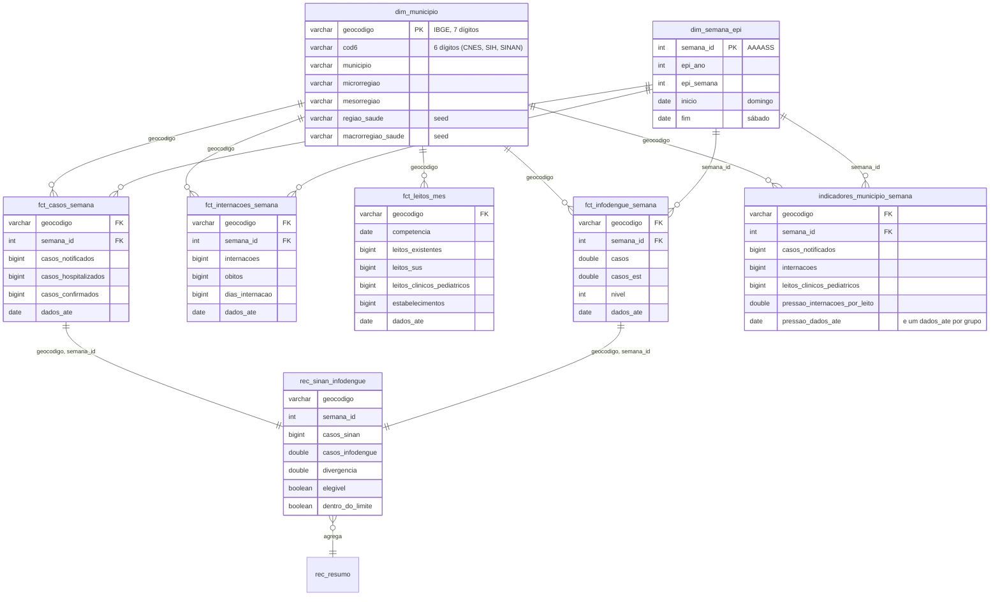

# Modelo de dados da camada tratada (R4)

Esquemas no DuckDB (`data/plataforma.duckdb`): `tratada` (dimensões, staging e fatos) e `final` (reconciliação; a tabela final do R7 entra aqui).

Os fatos são esparsos (só há linha onde houve registro); a densificação município x semana (853 municípios, todas as semanas) é feita na tabela final `final.indicadores_municipio_semana` (R7; dicionário em `docs/dicionario_dados.md`). Os modelos `stg_*` limpam e tipam a bruta; regras em `docs/adr/0004-tratada-e-reconciliacao.md`.
